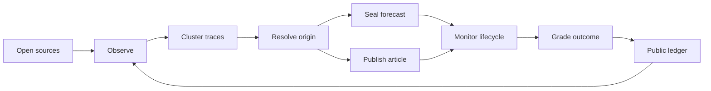

# The Loom

**A living observatory and encyclopedia of internet culture.**

The Loom follows internet culture while it is still unfolding. It identifies emerging memes, resolves their earliest documented traces, maps how they cross platforms, models their lifecycle, and publishes accountable forecasts before the outcome is known.

This repository contains the public-facing observatory: an editorial, data-rich introduction to the system and its method.

## What is inside

- **Interactive propagation web** — a draggable, filterable canvas graph showing origin, time rings, platform spokes, and individual cultural traces.
- **Lifecycle console** — four specimen histories with rising, peaking, holding, fading, and faded states.
- **Anatomy of a meme** — origin resolution, attention velocity, platform migration, and remix density.
- **Forecast ledger** — calibration, miss inspection, and a cryptographically sealed forecast record.
- **Research log** — a continuously updating view of collection, comparison, classification, and scoring tasks.
- **Method** — the full observe → resolve → forecast → publish → score loop.

## Run locally

No build step or application framework is required.

```bash
npm run preview
```

Then open `http://localhost:4173`.

You can also serve the directory with any static web server or open `index.html` directly.

## Project structure

```text
the-loom/
├── assets/
│   └── loom-mark.svg
├── index.html
├── serve.js
├── script.js
├── styles.css
├── package.json
└── README.md
```

## Design system

| Token | Value | Use |
|---|---:|---|
| Paper | `#f2f0e9` | Editorial surface |
| Ink | `#111319` | Primary type and controls |
| Link blue | `#2f5fd0` | The only page accent |
| Specimen night | `#0c0f14` | Observatory plates |
| Silk | `#a9bfdc` | Network threads |
| Display | EB Garamond | Headings and editorial voice |
| Interface | Geist | Navigation, body, and data labels |

The page is responsive down to mobile widths and respects `prefers-reduced-motion`.

## System model

The interface represents the public surface of a larger research loop:



### Core entities

- **Specimen** — the cultural object under observation.
- **Trace** — one timestamped appearance on a source platform.
- **Edge** — evidence that one trace influenced or preceded another.
- **Stage** — the current lifecycle classification.
- **Forecast** — a time-bounded, immutable claim with explicit confidence.
- **Resolution** — the observed outcome used to grade a forecast.

## Data integration seams

The visual layer is intentionally plain JavaScript. Production feeds can be connected by replacing the local collections in `script.js` with API responses while retaining the renderers:

- `nodes` and `links` power the propagation web;
- `specimens` powers lifecycle histories;
- `logData` powers the public research ledger.

Recommended record shapes:

```ts
type Trace = {
  id: string;
  specimenId: string;
  platform: "tiktok" | "x" | "instagram" | "reddit" | "youtube" | "search" | "press";
  observedAt: string;
  sourceUrl: string;
  parentTraceId?: string;
  kind: "origin" | "copy" | "reaction" | "remix" | "reference";
};

type Forecast = {
  specimenId: string;
  claim: string;
  confidence: number;
  horizonEndsAt: string;
  sealedAt: string;
  digest: string;
  resolution?: "inside_bounds" | "outside_bounds";
};
```

## Principles

1. Sources before summaries.
2. Timestamps before hindsight.
3. Confidence before certainty.
4. Misses remain visible.
5. Every conclusion keeps a path back to evidence.

---

The Loom — watching ideas become folklore.
